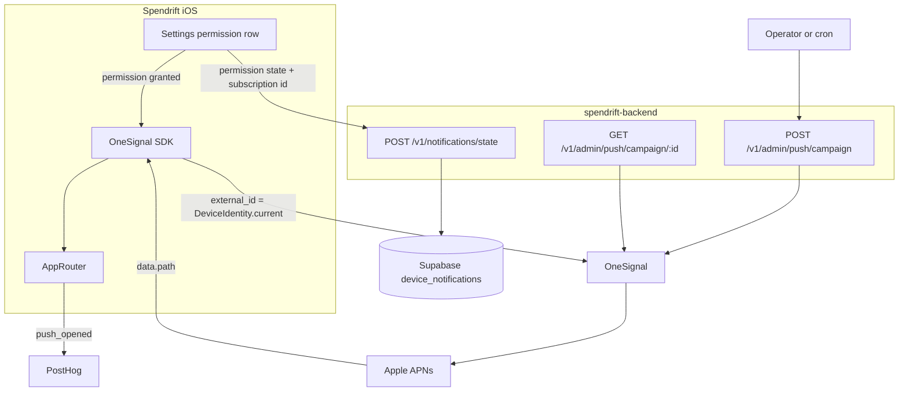

# Notifications

Proposal only.
No implementation in this document.

Spendrift today only sends **local** notifications.
`NotificationManager` schedules spend reminders and `ProTrialReminder` schedules a trial warning, both through `UNUserNotificationCenter`.
Nothing can reach a user whose app is closed unless the device already holds the scheduled request.

This document specifies remote push: an API we can call to reach every install through APNs, a route carried in the payload, an opt-in surface in Settings, and the telemetry to tell whether any of it works.

---

## What ships

1. **OneSignal** as the push gateway, wired to APNs with our own `.p8` auth key.
2. A **`device_notifications` table** in Supabase keyed by `device_id`, so we can count how many installs have notifications on.
3. A **permission row in Settings** directly below Feedback, shown only while permission is missing.
4. A **monthly quota-refill notification**, scheduled locally, for free-tier users.
5. A **campaign API** on the backend that we call to broadcast a notification carrying a page path such as `/feedback`.

Non-goals for this pass: in-app messaging, per-user scheduling, journeys, segmentation beyond "everyone" and "these device ids", and localisation.

---

## Architecture



Two systems, two jobs.
OneSignal answers "was it sent, delivered, and tapped".
PostHog answers "did the tap lead to the thing we wanted".
They join on `device_id`, which is already the shared key across PostHog, Sentry, and Supabase.

### Why OneSignal

Push is more than posting to APNs.
Token lifecycle, sandbox versus production, invalid-token pruning, retries, confirmed delivery, and a sent/delivered/clicked funnel are all real work with no product value.

PostHog Workflows now has a push channel, which is tempting because the SDK is already in the app.
It is not the right choice yet: it is in beta, requires `posthog-ios` 3.69.0 or newer against our pinned 3.60.0, its campaign reporting is thinner than OneSignal's, and its targeting model assumes `identify()`, which Spendrift deliberately never calls.
Revisit once push leaves beta.

Firebase Cloud Messaging is transport, not a campaign product, and would leave us storing tokens and building reporting by hand.

---

## Identity

`OneSignal.login(DeviceIdentity.current)` sets the OneSignal external id to the same Keychain-backed UUID already used everywhere else.

```swift
// Spendrift/Services/Identity/DeviceIdentity.swift
static var current: String   // Keychain, survives reinstall
```

No accounts, no email, no `identify()`.
Targeting a single install from the campaign API means passing `device_ids`, which map straight to OneSignal `include_aliases.external_id`.

---

## iOS integration

### Packages and targets

Add `https://github.com/OneSignal/OneSignal-iOS-SDK` via SPM.

- `OneSignalFramework` on the `Spendrift` target.
- `OneSignalExtension` on a new **Notification Service Extension** target, `SpendriftNotificationServiceExtension`.

The service extension is not optional.
Without it OneSignal reports only "APNs accepted the payload", never confirmed delivery, and rich media never renders.
It needs an App Group, and we already have one: `IntentSwiftData.appGroupID`.
Reuse it rather than creating a second.

### Capabilities

- Push Notifications on the app target.
- Background Modes with Remote notifications on the app target.
- App Groups on both the app and the extension.
- An APNs Auth Key (`.p8`) uploaded to OneSignal, with the bundle id matching.

TestFlight and App Store builds use the **production** APNs environment.
A sandbox-only key will silently deliver nothing to TestFlight.

### Configuration

The app id follows the existing secret pattern rather than being hardcoded.

- `SpendriftOneSignalAppID` in `Info.plist`, fed from the xcconfig files alongside `SpendriftBackendClientToken`.
- Read through a new `AppSecrets.oneSignalAppID`.

Also set `OneSignal_suppress_launch_urls` to `YES` in `Info.plist`.
OneSignal's iOS SDK opens a Launch URL with `openURL`, which bounces through Safari and back even for correctly configured Universal Links.
We never send a `url`, only `data`, and we route from the click listener, so this flag removes the failure mode entirely.

### Initialisation gate

Mirror the PostHog gate in `Analytics.isPostHogEnabled`: App Store and TestFlight only, never Debug or Simulator.
Local builds must not register tokens or pollute the subscription list.

Initialise in `AppDelegate.application(_:didFinishLaunchingWithOptions:)`, before the SwiftUI hierarchy exists, so a cold-start tap is not lost.
Do **not** call `OneSignal.Notifications.requestPermission` here.
Permission is requested only from the Settings row, on an explicit user action, with the incentive on screen.

### Payload contract

Every campaign carries exactly two custom fields:

```json
{
  "path": "/feedback",
  "campaign": "feedback_nudge_v1"
}
```

`path` is the route.
`campaign` is an opaque label used to join OneSignal's per-message stats to PostHog funnels.

---

## Routing

### Route type

A new `Spendrift/Services/Navigation/AppRoute.swift`:

```swift
enum AppRoute: String, CaseIterable {
    case feedback = "/feedback"
    case explore  = "/explore"
}
```

The initialiser is tolerant: it trims whitespace, tolerates a missing leading slash, lowercases, and drops any query string.
An unknown path is ignored rather than guessed at, and reported to PostHog as `push_opened` with `path_unknown`.

The same allowlist is duplicated in the backend Zod schema so a typo cannot broadcast a dead notification to the whole install base.

### Router

Both destinations live under Settings, so a single router is enough.

```swift
@Observable
final class AppRouter {
    enum SettingsDestination: Hashable { case feedback, explore }

    var settingsPath: [SettingsDestination] = []
    fileprivate(set) var pending: AppRoute?

    func request(_ route: AppRoute) { pending = route }
    func consume() -> AppRoute? { defer { pending = nil }; return pending }
}
```

`AppRouter` is created in `RootContainerView` and injected into the environment.
The OneSignal click listener calls `request(_:)`.
`ContentView` drains `pending` on appear and on change, sets `selectedTab = 3`, and pushes onto `settingsPath`.

The pending buffer exists because a cold-start tap fires the click listener before any SwiftUI view is on screen.
Routing directly from the listener would drop the navigation.

### SettingsView refactor

`SettingsView` currently wraps a bare `NavigationStack` with two inline `NavigationLink` destinations.
It becomes path-driven:

- `NavigationStack(path: $router.settingsPath)`.
- `.navigationDestination(for: AppRouter.SettingsDestination.self)` mapping `.feedback` to `FeedbackView()` and `.explore` to `ExploreSettingsView()`.
- The existing rows become `NavigationLink(value:)` instead of `NavigationLink { ... }`.

Behaviour for a user tapping the rows by hand is unchanged.

### Existing deep links stay as they are

`spendrift://createTransaction`, `voiceExpense`, `importStatement`, and `importReceipt` keep their current host-based handling in `ContentView.handleQuickAction(url:)`.
Push routes are a separate, path-based channel and do not go through `UIApplication.shared.open`.

---

## Settings: permission row

### Placement

Directly below Feedback in `hubSection`, which pushes Explore to index 2 and raises `hubRowCount` from 4 to 5.

### Visibility

Shown only while `UNAuthorizationStatus` is `.notDetermined` or `.denied`.
Once authorized the row disappears permanently.
Turning notifications back off is the system's job, not ours, so no off switch ships in the app.

Status is read asynchronously on appear and re-read when the scene becomes active, because the user can change it in the system Settings app while we are backgrounded.

### Behaviour

`SettingsListItem` already supports `.toggle(Binding<Bool>)`, so no new component is needed.

- **`.notDetermined`**: flipping the toggle on calls `NotificationManager.requestAuthorization()`.
  On grant, register with OneSignal, sync state to the backend, and let the row disappear.
  On refusal, the toggle springs back off and the row stays.
- **`.denied`**: the row opens `UIApplication.openSettingsURLString` instead of prompting, because iOS will not show the system prompt a second time.
  A toggle that does nothing is worse than no toggle.

### Copy

The original idea was "Get 1 day of Pro usage".
That does not survive contact with the code: `ProEntitlement.isPro` is derived from StoreKit and `ProEntitlementCache` only mirrors it, so a fake 24-hour Pro window would have the app claiming a subscription the user does not have, in the paywall and in the Pro settings section.

Free credits are given on install and are not an incentive for notification permission.
See [Free credits](#free-credits).

---

## Free credits

Every free user gets the full monthly allowance from the first time `AIQuotaStore` sees the install.
Notification permission does not change that allowance.

### Rules

- `monthlyAllowance` is `monthlyFreeQuota` from the first launch.
- Granting or declining notifications, in onboarding or in Settings, does not add or withhold credits.
- The voice demo in onboarding is exempt from the quota (`QuotaPolicy.exempt`): it runs before the notification page, needs no credit, and does not spend one.

### Arithmetic

```
monthlyAllowance(feature) = monthlyFreeQuota
remaining(feature) = max(0, monthlyAllowance(feature) - used)
```

`consume` clamps stored usage at the allowance.

### Surfacing

`ProStatsRingsView` computes against `monthlyAllowance` and always shows remaining credits.
The onboarding notification page only asks for permission.

---

## Monthly quota-refill notification

### Why local

The refill itself is lazy.
`AIQuotaStore.rolloverIfNeeded` only runs when the app reads or writes a quota, so nothing at all happens on the first of the month unless the user opens the app.

A local repeating notification is deterministic, works offline, needs no backend cron, and needs no Pro or free status mirrored onto OneSignal subscriptions.

### Schedule

- Identifier `spendrift.quota.refill.monthly`.
- `UNCalendarNotificationTrigger` with `day = 1`, repeating.
- Scheduled only when notification permission is granted **and** `ProEntitlementCache.isPro` is false, since subscribers have no quota to refill.
- Cancelled when the user becomes Pro.

`RootContainerView.refreshTrialReminder()` already reacts to `entitlement.status` changes and is the natural place to hook the schedule and cancel.

Copy:

> **Your free AI credits are back**
> Voice notes, receipts, and a bank statement parse just refilled for the month.

### Bug to fix on the way in

`NotificationManager.reschedule(enabled:hour:minute:)` opens with `center.removeAllPendingNotificationRequests()`.

That wipes every pending request in the app, not just the daily reminders it is about to rewrite.
It already silently destroys `ProTrialReminder`'s `spendrift.pro.trialEnding` request any time the user changes their reminder time, and it would destroy the refill notification too.

Replace the blanket clear with `removePendingNotificationRequests(withIdentifiers:)` scoped to the reminder identifiers this function owns.

---

## Supabase: `device_notifications`

New migration under `supabase/migrations/`, following the existing service-role-only pattern.

```sql
create table if not exists public.device_notifications (
    device_id                 text primary key,
    permission_status         text not null,
    permission_granted_at     timestamptz,
    onesignal_subscription_id text,
    reward_granted            boolean not null default false,
    reward_granted_at         timestamptz,
    app_version               text not null,
    created_at                timestamptz not null default now(),
    updated_at                timestamptz not null default now()
);

create index if not exists device_notifications_status_idx
    on public.device_notifications (permission_status);

alter table public.device_notifications enable row level security;

-- No anon/authenticated policies. Backend uses service role only.
```

`permission_status` is one of `not_determined`, `denied`, `authorized`, `provisional`, `ephemeral`.

`device_id` is a plain text primary key with no foreign key to `devices`, matching how `feedback.device_id` is modelled.
A foreign key would make notification state fail whenever the launch insert had not landed yet.

Answering the original question is then one query:

```sql
select count(*) from public.device_notifications where permission_status = 'authorized';
```

---

## Backend

### New environment variables

Added to the Zod schema in `src/config/env.ts` and to `.env.example`:

- `ONESIGNAL_APP_ID`
- `ONESIGNAL_REST_API_KEY`
- `SPENDRIFT_ADMIN_TOKENS`, comma-separated, parsed into `env.adminTokens` exactly like `clientTokens`

### Admin auth

There is no admin pattern in the backend today.
`requireAuth` validates against `SPENDRIFT_CLIENT_TOKENS`, and that token ships inside the iOS binary, so reusing it would let any user with a jailbroken device or a proxy broadcast to the entire install base.

Add `requireAdminAuth` beside `requireAuth` in `src/middleware/auth.ts`, validating against `env.adminTokens`.
Mount campaign routes under `/v1/admin`, never with the client token.

### Endpoints

**`POST /v1/notifications/state`** - `requireAuth`, called by the app.

```json
{
  "device_id": "uuid",
  "app_version": "1.4.0 (88)",
  "permission_status": "authorized",
  "onesignal_subscription_id": "…",
  "reward_granted": true
}
```

Upserts via PostgREST with `Prefer: resolution=merge-duplicates,return=minimal`.
The device is the source of truth for its own state, so a full-row merge is correct and avoids the read-then-write dance in `supabaseDevices.ts`.

**`POST /v1/admin/push/campaign`** - `requireAdminAuth`, the endpoint we call.

```json
{
  "title": "Spendrift improves from your feedback",
  "body": "Got 30 seconds? Your notes actually change the app.",
  "path": "/feedback",
  "campaign": "feedback_nudge_v1",
  "audience": { "kind": "all" },
  "dry_run": false
}
```

`audience` is either `{ "kind": "all" }`, which maps to the `Subscribed Users` segment, or `{ "kind": "devices", "device_ids": [...] }`, which maps to `include_aliases.external_id`.

`path` is validated against the same `/feedback` and `/explore` allowlist the app knows.
This is the single most valuable guard here: an unvalidated path is a notification that opens nothing, sent to everyone, unrecallable.

`dry_run` resolves and validates the request, returns the payload that would be sent, and does not call OneSignal.

Responds `201 { "id": "...", "recipients": 1234 }`.

**`GET /v1/admin/push/campaign/:id`** - `requireAdminAuth`, proxies OneSignal's View Message with `outcome_names=os__click.count,os__confirmed_delivery.count` so campaign performance is readable without opening the OneSignal dashboard.

### Files

Matching existing conventions:

- `src/types/notificationState.ts` and `src/types/pushCampaign.ts`, plus co-located `.test.ts` Zod tests
- `src/services/supabaseNotifications.ts`, using `supabaseFetch`
- `src/services/oneSignalClient.ts`, wrapping failures in `ApiError(502, "upstream_failed", ...)`
- `src/routes/notifications.ts` and `src/routes/adminPush.ts`
- `"notifications"` added to `DiagnosticsFeature` in `src/diagnostics.ts` and to `featureForRoute` in `src/middleware/errorHandler.ts`
- `docs/openapi.yaml` updated, with the admin token documented as a separate security scheme

### Example call

```bash
curl -X POST https://api.spendrift.ronakpunase.dev/v1/admin/push/campaign \
  -H "Authorization: Bearer $SPENDRIFT_ADMIN_TOKEN" \
  -H "Content-Type: application/json" \
  -d '{
    "title": "Spendrift improves from your feedback",
    "body": "Got 30 seconds? Your notes actually change the app.",
    "path": "/feedback",
    "campaign": "feedback_nudge_v1",
    "audience": { "kind": "all" }
  }'
```

---

## Telemetry

### Split of responsibilities

- **OneSignal**: sent, confirmed delivered, clicked, per message and per campaign.
- **PostHog**: what happened after the tap.
- **Supabase**: how many installs are reachable at all.

### New and reused events

`notification_opened` already exists and is captured in `AppDelegate`.
Reuse it for push, with `kind: "push"` plus two new property keys on `Analytics.Key`:

- `path`
- `campaign`

`notification_permission_requested` and `notification_permission_granted` already exist and cover the permission prompt without change.
Free credits are not a notification event.

### The funnel that matters

```
push sent (OneSignal)
  -> confirmed delivery (OneSignal, requires the service extension)
    -> notification_opened  path=/feedback  campaign=feedback_nudge_v1  (PostHog)
      -> feedback_submitted (PostHog)
```

Without the service extension the second step does not exist and "delivered" degrades to "Apple accepted it".

---

## Apple and OneSignal setup checklist

This is manual work no SDK removes.

1. Create the OneSignal app, platform iOS, bundle id matching `Spendrift`.
2. Generate an APNs Auth Key `.p8` in the Apple Developer portal and upload it to OneSignal with the key id and team id.
3. Enable Push Notifications and Background Modes / Remote notifications on the app target.
4. Add the Notification Service Extension target and put `IntentSwiftData.appGroupID` on both targets.
5. Put the OneSignal app id into the xcconfig files and surface it through `Info.plist`.
6. Set `OneSignal_suppress_launch_urls` to `YES`.
7. Put `ONESIGNAL_APP_ID`, `ONESIGNAL_REST_API_KEY`, and `SPENDRIFT_ADMIN_TOKENS` into the backend `.env` on the VPS.
8. Apply the Supabase migration.
9. Verify on a TestFlight build, not the Simulator: push does not work in the Simulator for a real APNs round trip.

---

## Rollout

1. Migration and backend endpoints, with the campaign route reachable but no app registering yet.
2. OneSignal SDK, service extension, and the Settings row, shipped to TestFlight.
3. Confirm on a TestFlight device that a `dry_run: false` campaign to a single `device_id` arrives while the app is force-quit and opens the feedback page.
4. Only then broadcast to `{ "kind": "all" }`.

The first real campaign is the feedback nudge, because it is the one with a measurable downstream event in `feedback_submitted`.
